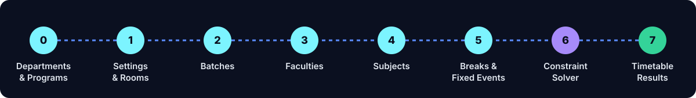
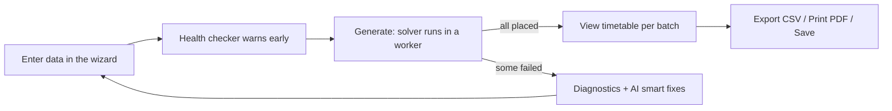
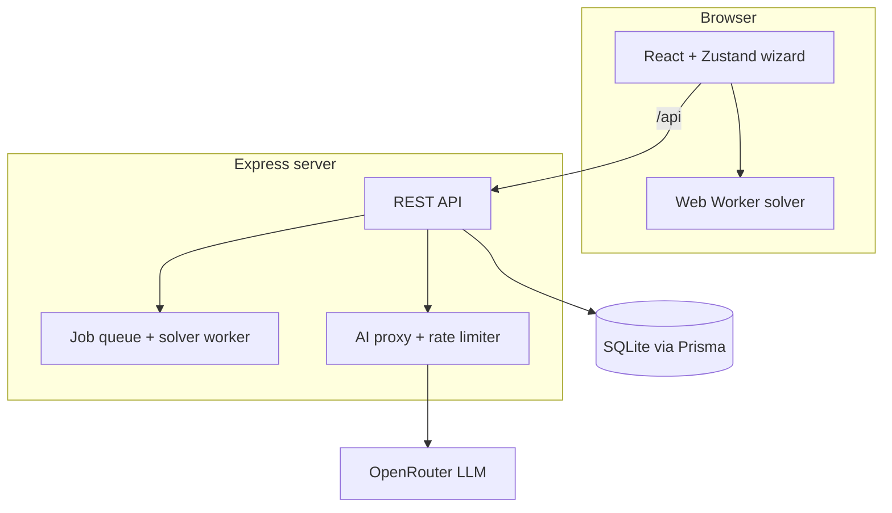

<div align="center">



# IBP Timetable Generator

**Free, smart college and university timetable maker, with an automatic constraint solver and an AI co-pilot.**

[](https://ibptimebook.vercel.app/)


</div>

---

## Table of contents

- [What is IBP Timetable Generator?](#what-is-ibp-timetable-generator)
- [Features](#features)
- [How it works](#how-it-works)
- [Screenshots](#screenshots)
- [Tech stack](#tech-stack)
- [Architecture](#architecture)
- [Project structure](#project-structure)
- [Getting started](#getting-started)
- [Environment variables](#environment-variables)
- [API reference](#api-reference)
- [The solver in detail](#the-solver-in-detail)
- [Deployment](#deployment)
- [Roadmap](#roadmap)
- [Contributing](#contributing)
- [License](#license)

## What is IBP Timetable Generator?

Making a college timetable by hand means juggling teachers, rooms, labs, batches and electives, and one clash breaks everything. **IBP Timetable Generator** is a web app where you enter your institution's data once and it builds a **conflict-free timetable automatically**. If something cannot be placed, it tells you *why* and suggests the smallest fix.

> **Live app:** https://ibptimebook.vercel.app/

## Features

| | Feature | Details |
|---|---|---|
| 🧭 | **8-step guided wizard** | Departments, settings and rooms, batches, faculty, subjects, breaks and fixed events, solver, results |
| ⚙️ | **Constraint solver** | Backtracking CSP with MRV heuristic, hard constraints and soft-constraint ranking, runs in a Web Worker so the UI stays smooth |
| 🧑‍🏫 | **Faculty rules** | Weekly and daily slot caps, average leaves, per-faculty unavailability windows |
| 🏫 | **Rooms and labs** | Theory rooms and labs with capacity, building, floor and equipment, plus department-specific or shared rooms |
| 🎓 | **Batches and electives** | A subject linked to several batches is scheduled as an elective in one common slot |
| 📌 | **Fixed slots and breaks** | Pin a subject to a day and time, add breaks and fixed events |
| 📥 | **Excel import** | Bulk-import faculty and rooms from `.xlsx` sheets |
| 🤖 | **AI co-pilot** | Live tips, chat, "smart fix" suggestions and a tool-calling agent that queries your live timetable data |
| 🩺 | **Health checker** | Warns about overloaded batches, rooms and faculty before you even run the solver |
| ✅ | **Validation summary** | Clear failure diagnostics for every session that could not be placed |
| 🔎 | **Command palette** | Jump to any step, toggle theme or find entities from the keyboard |
| 👋 | **Onboarding tour** | Step-by-step intro for first-time users |
| 🌗 | **Dark and light themes** | Remembers your choice |
| 💾 | **Save and load** | Save configurations and timetables to the database, or import/export config as JSON |
| 📤 | **Export** | CSV export and print-ready or PDF output |

## How it works





## Screenshots

> Add your own images to `docs/screenshots/` and they will show up here.

| Wizard | Solver | Results |
|---|---|---|
|  |  |  |

Tip: record a short GIF of generating a timetable (for example with ScreenToGif or Kap), save it as `docs/demo.gif` and add `` here. A moving demo makes a big difference for repo visitors.

## Tech stack

**Frontend:** React 18, TypeScript, Vite, Tailwind CSS, Zustand (persisted store), dnd-kit (drag and drop), Lucide icons, Sonner toasts, SheetJS (`xlsx`)

**Backend:** Node.js, Express, Prisma ORM, SQLite (PostgreSQL ready), express-rate-limit, Vitest

**AI:** OpenRouter API (`deepseek/deepseek-chat`), proxied through the backend so the API key never reaches the browser

**Hosting:** Vercel for the client

## Architecture



## Project structure

```text
TIMETABLE/
├── client/                    # React + Vite + Tailwind app
│   ├── src/
│   │   ├── components/        # Wizard, AiPanel, CommandPalette, Header, steps/Step0..Step7
│   │   ├── scheduler/         # solver.ts + worker.ts (runs in the browser)
│   │   ├── store/             # Zustand store (useTimetableStore)
│   │   ├── api/ lib/          # API client helpers
│   │   └── types.ts
│   ├── public/                # favicon, og-image, robots.txt, sitemap.xml
│   └── vercel.json            # SPA rewrite
├── server/                    # Express API
│   ├── src/
│   │   ├── server.ts          # routes + AI proxy
│   │   ├── jobs.ts            # background solver jobs
│   │   └── scheduler/         # solver.ts + worker.ts
│   └── prisma/                # schema.prisma + migrations
├── index.html, app.js, styles.css   # original vanilla-JS version (legacy)
├── firestore.rules            # legacy Firebase rules
└── .env.example
```

## Getting started

**Requirements:** Node.js 18+ and npm.

```bash
# 1. Clone
git clone https://github.com/YOUR_USERNAME/ibp-timetable-generator.git
cd ibp-timetable-generator

# 2. Install everything and generate the Prisma client
npm run install:all

# 3. Create your env file
cp .env.example .env        # then add your OpenRouter key

# 4. Create the database
npm run db:migrate

# 5. Start client and server together
npm run dev
```

- Client: http://localhost:3000 (proxies `/api` to the server)
- Server: http://localhost:5000

| Script | What it does |
|---|---|
| `npm run dev` | Runs server and client together |
| `npm run build` | Builds server and client |
| `npm test` | Runs server tests (Vitest) |
| `npm run db:migrate` | Runs Prisma migrations |
| `npm run db:generate` | Generates the Prisma client |

## Environment variables

| Variable | Description | Example |
|---|---|---|
| `PORT` | Backend port | `5000` |
| `DATABASE_URL` | Prisma database URL | `file:./dev.db` |
| `OPENROUTER_API_KEY` | Key for the AI co-pilot (kept server-side) | `sk-or-...` |
| `VITE_API_URL` | (client) Base URL of your deployed backend | `https://api.example.com` |

## API reference

| Method | Endpoint | Purpose |
|---|---|---|
| POST | `/api/schedule/generate` | Start a solver job |
| GET | `/api/schedule/jobs/:id` | Poll job progress and result |
| POST | `/api/schedule/jobs/:id/cancel` | Cancel a running job |
| GET / POST | `/api/configs` | List or save configurations |
| GET / PUT / DELETE | `/api/configs/:id` | Load, update or delete a configuration |
| GET / POST | `/api/timetables` | List or save generated timetables |
| GET / DELETE | `/api/timetables/:id` | Load or delete a timetable |
| POST | `/api/ai/tip` | Contextual AI tips |
| POST | `/api/ai/chat` | AI chat about your setup |
| POST | `/api/ai/suggest-fix` | Minimal-edit fix suggestions |
| POST | `/api/ai/agent` | Tool-calling AI agent |

## The solver in detail

The scheduler is a **constraint satisfaction solver** using backtracking search:

1. **Variables:** one per class session (a subject with 3 classes per week becomes 3 sessions).
2. **Domains:** every valid combination of time block and room.
3. **Variable ordering:** MRV (fewest remaining options first), with electives and longer sessions as tie-breakers.
4. **Hard constraints:** no clash for a batch, faculty member or room; fixed slots respected; breaks and unavailability honoured; faculty weekly and daily caps; max classes per day.
5. **Soft constraints:** spread subjects across the week and reduce faculty gaps when ranking choices.
6. **Diagnostics:** anything unplaced gets a human-readable reason.

## Deployment

- **Client:** import the repo in Vercel, set the root directory to `client`, build command `npm run build`, output `dist`. `vercel.json` already rewrites all routes to `index.html`.
- **Server:** deploy `server/` to a Node host (Render, Railway, Fly.io), set `DATABASE_URL` and `OPENROUTER_API_KEY`, and set `VITE_API_URL` on the client to that server URL.
- For production, prefer PostgreSQL over SQLite (change the provider in `server/prisma/schema.prisma`).

## Roadmap

- [ ] User accounts and login
- [ ] Share timetables with a public link
- [ ] Per-faculty and per-room timetable views
- [ ] Drag-and-drop manual edits with live clash checks
- [ ] Multi-language support

## Contributing

Pull requests are welcome. Fork the repo, create a branch (`git checkout -b feature/my-feature`), commit, push, and open a PR.

## License

Released under the **MIT License**. Add a `LICENSE` file to the repo root to make this official.

---

<div align="center">

If this project helped you, please **⭐ star the repo**, it helps others find it.

[Live Demo](https://ibptimebook.vercel.app/) · [Report a bug](../../issues) · [Request a feature](../../issues)

</div>
