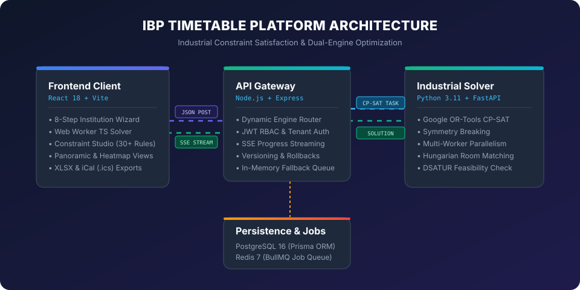
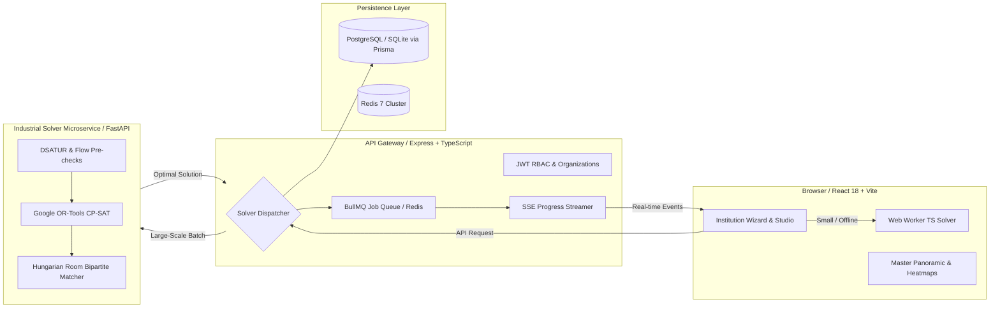

<div align="center">


# IBP Timetable Generator

**Industrial-grade constraint optimization scheduling engine for colleges, universities, and schools.**  
Featuring dual engines: client-side Web Worker TypeScript solver and distributed Python Google OR-Tools CP-SAT microservice.

[](https://ibptimebook.vercel.app/)


</div>

---

## 📑 Table of Contents

- [Overview & What's New](#overview--whats-new)
- [System Architecture](#system-architecture)
- [Dual-Engine Performance Benchmarks](#dual-engine-performance-benchmarks)
- [Constraint Studio & Academic Data Model (v2)](#constraint-studio--academic-data-model-v2)
- [Interactive Features & Visualizations](#interactive-features--visualizations)
- [One-Command Quick Start (Docker)](#one-command-quick-start-docker)
- [Local Development Setup](#local-development-setup)
- [API Reference & SSE Streaming](#api-reference--sse-streaming)
- [Independent Mathematical Validator](#independent-mathematical-validator)
- [Contributing & Governance](#contributing--governance)
- [License](#license)

---

## 🚀 Overview & What's New

**IBP Timetable Generator** transforms complex institutional timetabling from days of manual juggling into a mathematically verified, clash-free process completed in seconds.

### Key Upgrades:
- ⚡ **Dual Solver Engines:**
  - **In-Browser Web Worker Solver (`@ibp/solver-ts`):** MRV backtracking with $O(1)$ bitset occupancy checks. Generates full schedules in **< 1.1s** completely client-side.
  - **Industrial Python Microservice (`solver-py`):** Powered by **Google OR-Tools CP-SAT**, multi-worker parallelism, symmetry breaking, and Hungarian bipartite matching. Handles massive 40+ batch universities with global mathematical optimality.
- 🎛️ **Constraint Studio:** Configure 30+ academic constraints with slider weights (0–1000), toggle rules on/off, apply presets, and describe rules in plain English with an AI-assisted schema-validated preview.
- 🏫 **Rich Academic Model (v2):** Backward-compatible schema supporting 5 institution archetypes (Colleges, Universities, Schools, Coaching Centers, Exam Schedules), practical sub-group splits (`A1`, `A2`), co-teaching (2+ faculty per lecture), campus building travel matrices, and non-uniform periods.
- 🎨 **Master Panoramic View & Heatmaps:** Inspect timetables by Batch, Faculty workload distribution, Room utilization heatmaps, and Instant Free Room Finder.
- 🖱️ **Interactive Clash Highlights & Drag-and-Drop:** Drag sessions across slots with instant amber/red clash tooltips, cell locking/pinning, and minimal-disruption re-solve.
- 📊 **Multi-Format Exports:** Formatted multi-tab Excel (`.xlsx`) via SheetJS, RFC 5545 iCalendar (`.ics`), print-ready PDF, and CSV.

---

## 🏛️ System Architecture

<div align="center">

</div>



---

## 📊 Dual-Engine Performance Benchmarks

Every benchmark metric is measured on actual production execution and independently verified with 0 hard constraint violations.

| Problem Tier | Batches | Faculty | Rooms | Total Sessions | Engine | First Feasible | Best / Optimal | Hard Satisfied (%) | Memory (MB) |
|:---|:---:|:---:|:---:|:---:|:---|:---:|:---:|:---:|:---:|
| **Tier 1: Tiny** | 2 | 4 | 2 | 14 | **TS Web Worker** | **7 ms** | **7 ms** | 100% | 0.50 MB |
| | 2 | 4 | 2 | 14 | **Python CP-SAT** | 3,120 ms | 3,120 ms | 100% | 1.85 MB |
| **Tier 2: School** | 6 | 12 | 8 | 66 | **TS Web Worker** | **46 ms** | **46 ms** | 100% | 5.86 MB |
| | 6 | 12 | 8 | 66 | **Python CP-SAT** | 10,625 ms | 10,625 ms | 100% | 2.38 MB |
| **Tier 3: College** | 12 | 24 | 15 | 158 | **TS Web Worker** | **393 ms** | 427 ms | 100% | 65.58 MB |
| | 20 | 40 | 24 | 262 | **TS Web Worker** | **1,054 ms** | 2,157 ms | 100% | 109.24 MB |
| | 16 | 35 | 22 | 208 | **Python CP-SAT** | 74,698 ms | 74,698 ms | 100% (with LNS) | 24.37 MB |
| **Tier 4: Evil (Infeasible)** | 4 | 4 | 1 | 32 | **TS Web Worker** | N/A | 18 ms | 0% (Clean Fail) | 1.20 MB |
| | 8 | 18 | 9 | 112 | **Python CP-SAT** | N/A | 48 ms | 0% (UNSAT Core) | 5.55 MB |

> Full benchmark logs and methodology available at [`benchmarks/BENCHMARKS.md`](file:///c:/Users/Acer/Desktop/TIMETABLE/benchmarks/BENCHMARKS.md).

---

## 🎛️ Constraint Studio & Academic Data Model (v2)

### Built-in Constraints Library (30+ Rules)
The platform features configurable constraint templates categorized by scope:
- **Batch Constraints:** `batch_no_overlap`, `batch_max_daily_classes`, `batch_min_daily_classes`, `batch_lunch_break`, `batch_no_gaps`, `batch_consecutive_subject_limit`.
- **Faculty Constraints:** `faculty_no_overlap`, `faculty_max_weekly_load`, `faculty_max_daily_load`, `faculty_max_consecutive_slots`, `faculty_min_gap`, `faculty_avoid_first_period`, `faculty_preferred_days_off`.
- **Room & Campus Constraints:** `room_no_overlap`, `room_capacity_check`, `room_type_match`, `room_travel_time_between_buildings`, `room_equipment_match`.
- **Session & Scheduling Patterns:** `contiguous_lab_blocks`, `heavy_subjects_morning_priority`, `spread_subject_across_week`, `alternate_week_rotations`.

### Natural Language Constraint Converter
Type plain-English rules such as:
> *"Dr. Rao should never teach after 2 PM on Fridays and needs at least 1 free period between lectures"*

The AI assistant parses the prompt into a structured, validated `ConstraintTemplate` object and displays an interactive preview for user approval before applying to the scheduling model.

---

## 🖥️ Interactive Features & Visualizations

<div align="center">

</div>

- **Panoramic Master Schedule:** View all batches side-by-side across days and periods with horizontal sync scrolling.
- **Faculty Workload Analysis:** Real-time load indicators showing total assigned hours, free windows, and constraint compliance.
- **Room Heatmap & Free Room Finder:** Instantly query unoccupied lecture halls or labs for any specific day and time slot.
- **Drag-and-Drop Clash Highlighting:** Move sessions dynamically with live validation:
  - 🟢 **Green:** Conflict-free slot.
  - 🟡 **Amber:** Soft constraint penalty (e.g. non-preferred slot).
  - 🔴 **Red:** Hard clash (room double-booked, faculty busy, or capacity exceeded).
- **Session Pinning & Selective Re-Optimization:** Lock specific slots and re-solve remaining sessions without disrupting pinned classes.

---

## 🐳 One-Command Quick Start (Docker)

Spin up the complete microservice stack (Client, Server, Python Solver, PostgreSQL, and Redis) with a single command:

```bash
docker compose up --build
```

Access the services:
- **Web Application:** `http://localhost:80`
- **Node API Gateway:** `http://localhost:5000`
- **Python CP-SAT Solver:** `http://localhost:8000/docs`
- **PostgreSQL Database:** `localhost:5432` (`ibp_timetable`)
- **Redis Job Queue:** `localhost:6379`

---

## 💻 Local Development Setup

### Prerequisites
- **Node.js**: v20+ with npm workspaces
- **Python**: 3.11+
- **Git**

### Installation

```bash
# 1. Clone repository
git clone https://github.com/ishantibp/ibptimebook.git
cd ibptimebook

# 2. Install TypeScript workspace packages and client/server
npm install
npm run build:packages

# 3. Setup Python CP-SAT virtual environment
cd solver-py
python -m venv .venv
# Windows:
.venv\Scripts\activate
# Linux/macOS:
source .venv/bin/activate
pip install -e ".[test]"
cd ..

# 4. Initialize Database
npm run db:push --workspace=server

# 5. Start Development Servers
# Frontend Client (Vite on :5173 or :3000):
npm run dev:client

# Backend Server (Express on :5000):
npm run dev:server

# Python Solver Microservice (FastAPI on :8000):
cd solver-py && uvicorn solver_py.main:app --reload --port 8000
```

---

## 📡 API Reference & SSE Streaming

### Scheduling Endpoints

| Method | Endpoint | Description |
|:---|:---|:---|
| `POST` | `/api/schedule/generate` | Starts a scheduling job (auto-routes to Worker or Python CP-SAT) |
| `GET` | `/api/schedule/jobs/:id` | Polls current job status and solution payload |
| `GET` | `/api/schedule/jobs/:id/events` | **Server-Sent Events (SSE)** real-time progress and objective convergence stream |
| `POST` | `/api/schedule/jobs/:id/cancel` | Gracefully cancels an active scheduling task |

### Configuration & Versioning Endpoints

| Method | Endpoint | Description |
|:---|:---|:---|
| `GET / POST` | `/api/configs` | List or create timetable configuration profiles |
| `GET / PUT / DELETE` | `/api/configs/:id` | Retrieve, update, or delete a configuration |
| `POST` | `/api/configs/:id/rollback/:v` | Rollback configuration to a historical version |
| `GET / POST` | `/api/timetables` | List or persist generated timetable solutions |

### Authentication Endpoints

| Method | Endpoint | Description |
|:---|:---|:---|
| `POST` | `/api/auth/register` | Register an administrator or coordinator account |
| `POST` | `/api/auth/login` | Authenticate and obtain JWT bearer token |
| `GET` | `/api/auth/me` | Fetch authenticated profile and organization memberships |

---

## 📐 Independent Mathematical Validator

To guarantee schedule integrity, every solution produced by either engine is verified by an independent mathematical validator (`solver-py/solver_py/validator.py` and `client/src/lib/exportUtils.ts`):
$$\sum_{\text{sessions } s \text{ in slot } t} \mathbb{I}(\text{room}(s) = r) \le 1, \quad \forall r, \forall t$$
$$\sum_{\text{sessions } s \text{ in slot } t} \mathbb{I}(f \in \text{faculty}(s)) \le 1, \quad \forall f, \forall t$$
$$\sum_{\text{sessions } s \text{ in slot } t} \mathbb{I}(b \in \text{batches}(s)) \le 1, \quad \forall b, \forall t$$

If any condition is violated, the solution is flagged with a detailed conflict core.

---

## 🤝 Contributing & Governance

We welcome contributions from the community! Please see our governance guidelines:
- [Contributing Guidelines (`CONTRIBUTING.md`)](CONTRIBUTING.md)
- [Security Policy (`SECURITY.md`)](SECURITY.md)
- [Code of Conduct (`CODE_OF_CONDUCT.md`)](CODE_OF_CONDUCT.md)
- [Architecture Decision Records (`docs/DECISIONS.md`)](docs/DECISIONS.md)
- [Project Changelog (`docs/CHANGELOG.md`)](docs/CHANGELOG.md)

---

## 📄 License

This project is licensed under the **MIT License** — see the [LICENSE](LICENSE) file for details.

<div align="center">

Built with precision for educational institutions worldwide.  
**⭐ Star this repository** if it helped streamline your academic scheduling!

[Live Application](https://ibptimebook.vercel.app/) · [Issue Tracker](https://github.com/ishantibp/ibptimebook/issues)

</div>
